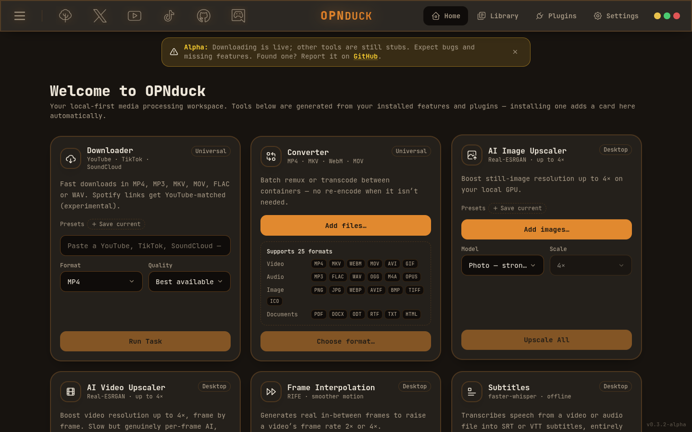
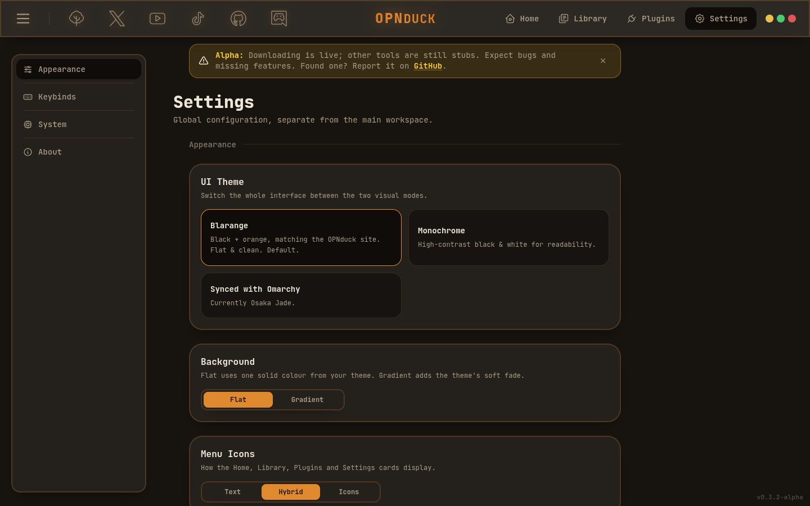

# OPNduck Desktop Suite 🦆

OPNduck is a local-first, open-source media processing suite. It brings powerful AI
upscaling, motion frame-interpolation, media downloads, conversions, and transcription
directly to your local GPU/CPU at zero cost — no subscriptions, no cloud, no spying. All
your media stays on your machine.

This is **v0.4.0-Beta**, the first Beta. It ships a much more capable Downloader (8K, subtitles,
dubbed audio tracks, whole channels and lists, sign-in for private content, Smart mode),
**Subscriptions** that auto-download new uploads while OPNduck is open, an **AI Audio** card
(Demucs: remove vocals, extract vocals, isolate a voice, echo and noise cleanup), Subtitles
(faster-whisper), Library management (search, filters, sorting, batch groups, JSON export/import),
a noticeably faster UI, and job queues, on top of the multi-format Converter, AI upscalers, frame
interpolation, theming, settings and the adaptive card dashboard. Beat Finder is still not wired in.
The Tauri migration is **postponed** (see Desktop Shell below); OPNduck ships on Electron.
AI Audio needs a Python venv with `torch`, `demucs` and `soundfile`; that install is large
(about 5.5 GB including the CUDA libraries).

<p align="center">
  
  
</p>

---

## 🎨 Design System

OPNduck uses a flat, solid look: no blur, no translucency. (Earlier builds used a
"Liquid Glass" style; that theme was flattened and renamed Blarange in v0.3.0.)

### Theme Engine

Switching happens in Settings → Appearance:

| Mode | Description |
| ---- | ----------- |
| **Blarange** (default) | Flat black + orange, matching the OPNduck website's palette. |
| **Monochrome** | Strict high-contrast black & white for maximum readability and minimal distraction. |
| **Synced with Omarchy** | Only shown on an Omarchy desktop; follows its live theme colors. |

Themes are implemented as CSS custom-property tokens switched by a single
`data-theme` attribute on `<html>`. Components never change, only tokens do.

---

## 🛠️ Built On & Technologies Used

- **Frontend**: React 19, TypeScript, Vite, Tailwind CSS v4, React Router, Framer Motion.
- **Desktop Shell**: Electron. A full Tauri v2 migration was built and verified
  (Rust backend, all feature pipelines ported, Windows sidecars vendored; kept on a local
  `tauri-migration-phase1` branch that isn't published on GitHub), but is **postponed, not shipping**: on Linux with
  an NVIDIA proprietary driver under Wayland, Tauri's webview (WebKitGTK) can't do
  hardware-accelerated compositing — it either segfaults, or falls back to a
  software-rendering path so slow the app is barely usable (confirmed against the
  identical build running fine in a normal browser, so this is a WebKitGTK/NVIDIA/Wayland
  platform bug, not an OPNduck bug). This is a known, long-standing upstream issue, not
  something fixable from application code. Revisit once it's resolved upstream, or if
  packaging specifically for Windows (WebView2, unaffected) or non-NVIDIA Linux.
- **Sidecar Engine (Master Engine)**: Python 3, packaged via PyInstaller.
- **AI Upscaler**: Real-ESRGAN (NCNN-Vulkan C++ Binary).
- **AI Interpolator**: RIFE (NCNN-Vulkan C++ Binary).
- **Media Downloader**: yt-dlp (wired in, real downloads).
- **Universal Converter**: FFmpeg (Hardware Accelerated).
- **Beat / Tempo Finder**: librosa.
- **Subtitles Generator**: faster-whisper (wired in, via your own Python 3 with
  `faster-whisper` installed; set `OPNDUCK_PYTHON` to use a venv's interpreter).

> Wired in now (as system binaries on the PATH): `yt-dlp`, FFmpeg, LibreOffice,
> Real-ESRGAN and RIFE, plus faster-whisper through your own Python. The Python sidecar
> and librosa are **not wired in yet**.

---

## 🖥️ Platform Support

- **Linux** — primary target, fully tested (currently in development on Arch Linux).
- **Windows** — first-class from the start; cross-platform scripts and path handling
  are baked in.
- **macOS** — planned later.

---

## 🌟 Key Feature Modules

1. **Media Downloader**: Download individual video/audio files or entire playlists from
   YouTube, TikTok, and SoundCloud up to 8K resolution. (Not Spotify — its tracks are
   DRM-protected and there's no legitimate way to pull audio directly from it.)
2. **Universal Transcoder**: Convert media formats using hardware-accelerated local
   FFmpeg pipelines. Supports both individual files and batch folder directories.
3. **AI Video Interpolator**: Increase frame rates (e.g. 24fps to 60fps) using local
   RIFE networks.
4. **AI Video Upscaler**: Reconstruct detail textures up to 4× using precompiled local
   Vulkan Real-ESRGAN engines.
5. **AI Image Upscaler**: High-speed, local neural super-resolution for image assets.
6. **Local BPM & Beat Finder**: Analyze tracks locally with librosa to extract BPM and
   find exact slice timestamps for editing.
7. **Local Subtitle Generator**: Free transcription using local faster-whisper models
   to export synchronized `.SRT` and `.VTT` tracks.

### Feature split

- **Universal (Web & Desktop)**: Media Downloader, Format Converter.
- **Desktop-exclusive (hardware intensive)**: AI Video Interpolation, AI Video & Image
  Upscaling, Community Plugin Ecosystem, Hardware Allocation Engine.

---

## 🚀 Setup & Local Execution

### 1. Prerequisite Installations

- **Node.js** (LTS v20+)

### 2. Install & run

```bash
npm install
npm run dev        # dev server → http://localhost:1420
npm run build      # type-check + production build
npm run preview    # preview the production build
npm run lint       # oxlint
```

The frontend runs in any browser today — it is the exact bundle the desktop shell
hosts. The Electron wrapper, downloader, converter, upscalers and interpolation are
wired in, as is Subtitles (faster-whisper); Beat Finder lands in a later update.

---

## 📝 Project Metadata & Licensing

- **Project State**: `v0.4.0-Beta` (most engines wired in; Beat Finder still stubbed — expect bugs!)
- **Original Developer**: Aaron
- **Development Model**: Built with the architectural assistance of AI.
- **License**: [GPL-3.0](./LICENSE) — free software. Copyright © 2026 Aaron Jonsson.

---

## ⚠️ An honest note from the developer

This project is made completely by AI/vibe-coding with human input and testing. If you
don't like that, sorry — I'm a single developer and can't afford to build all of this
alone. If you want to contribute and work on this project alongside me, you're welcome,
but don't expect to be paid anything.

Found a bug? Got a feature idea? Submit it — I'll review whether it belongs in OPNduck
core or should be a community plugin. **EXPECT BUGS.** 🦆